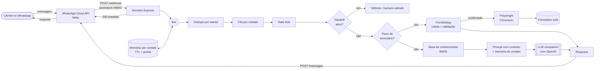

# whatsapp-ai-bot

Assistente de atendimento no **WhatsApp com IA**, em Node.js + TypeScript, usando a **WhatsApp Business Cloud API (oficial da Meta)**.
Responde com base na **sua própria base de conhecimento** (sem inventar), lembra da conversa de cada cliente,
passa para um **atendente humano** quando pedido e ainda **preenche formulários na web sozinho** (Playwright)
com os dados coletados na conversa.

> Projeto de portfólio/demonstração. A "Clínica Sorriso Exemplo", o FAQ e o endereço são **fictícios**. O FAQ não informa preço, promoção, serviço gratuito nem condição de pagamento (art. 44, I, do Código de Ética Odontológica): a pergunta de preço responde que o valor depende da avaliação e oferece agendar.

[](https://github.com/lsventura/whatsapp-ai-bot/actions/workflows/ci.yml)

## Funcionalidades

- **WhatsApp Cloud API oficial** — webhook com verificação de token e **validação de assinatura HMAC (`X-Hub-Signature-256`)**; sem risco de banimento por automação não-oficial.
- **Qualquer LLM compatível com OpenAI** — chave, modelo e `BASE_URL` por variável de ambiente (OpenAI, OpenRouter, Groq, Ollama, vLLM…). Retry automático em 429/5xx e timeout.
- **Respostas ancoradas em FAQ/base de conhecimento** (`knowledge/faq.json` ou `.md`) — busca lexical BM25 em português (sem acento/plural), trechos relevantes entram no prompt e o modelo é instruído a **não inventar**; se não souber, oferece atendente.
- **Memória por contato** — janela de N turnos e TTL, isolada por número.
- **Handoff para humano** — palavras-chave configuráveis (`atendente`, `humano`…); o bot silencia, opcionalmente avisa um número de atendente, e volta com `/bot` ou após um TTL.
- **Concorrência** — fila por contato (ordem garantida) + contatos em paralelo + semáforo para limitar chamadas simultâneas ao LLM.
- **Rate limit por contato** (janela deslizante) — avisa uma vez e ignora o excesso, protegendo seu custo de LLM.
- **Idempotência** — reenvios do webhook (mesmo `wamid`) são ignorados.
- **Automação de formulário com Playwright** — coleta os campos conversando (validação de e-mail, telefone BR, data, listas), confirma com o cliente, abre o Chromium, preenche e envia, e devolve o protocolo no WhatsApp. O formulário é **100% configurável por JSON**. Opcionalmente o LLM extrai vários campos de uma única mensagem.
- **Modo FAQ sem LLM** — sem `LLM_API_KEY` o bot ainda responde pela base de conhecimento, com **menu numerado** ("oi" ou "menu" mostra as opções, o número responde). Bom para testar e para custo zero.
- **Chat de terminal** (`npm run chat`) — testa tudo sem precisar de WhatsApp.
- **LGPD básico** — números mascarados nos logs, segredos só em variáveis de ambiente.
- Testes automatizados, ESLint, TypeScript `strict`, Dockerfile, CI no GitHub Actions.

## Arquitetura



Estrutura do código:

```
src/
  index.ts             # sobe o servidor (webhook)
  cli.ts               # chat de terminal para testes
  app.ts               # monta as peças a partir do .env
  bot.ts               # orquestração: dedupe → fila → rate limit → handoff → form → LLM
  server.ts            # rotas GET/POST /webhook, /health
  whatsapp/            # cloudApi (envio), parser (payload), signature (HMAC)
  llm/                 # cliente OpenAI-compatível
  knowledge/           # carga (JSON/MD) + busca BM25
  forms/               # FormDialog (máquina de estados), validators, PlaywrightFormSubmitter
  memory.ts            # sessões por contato
  rateLimiter.ts       # janela deslizante
  handoff.ts           # detecção de palavras-chave
  util/                # fila por chave, semáforo, texto, logs
knowledge/faq.json     # FAQ de exemplo (fictício)
examples/form-demo/    # formulário local de exemplo + form.config.json
tests/                 # unitários, integração e e2e (Playwright)
profitchart-ntsl/      # bônus: regras de coloração em NTSL (ProfitChart)
```

## Começando

Requisitos: **Node.js ≥ 20.12**.

```bash
git clone https://github.com/lsventura/whatsapp-ai-bot.git
cd whatsapp-ai-bot
npm install
npx playwright install chromium     # navegador usado pela automação de formulário
cp .env.example .env                # preencha o que precisar
```

### 1) Testar sem WhatsApp (1 minuto)

```bash
npm run chat
```

Sem `LLM_API_KEY` ele roda em modo FAQ; com a chave (e `LLM_MODEL`/`LLM_BASE_URL`) já usa o LLM.
Digite `quero agendar` para ver a coleta + preenchimento real do formulário de demonstração.

Exemplo de conversa (saída real do `npm run chat`, modo FAQ, sem LLM — condensada):

```text
você> que horas vocês abrem?
[bot] Atendemos de segunda a sexta, das 8h às 18h, e aos sábados das 8h às 12h. Domingos e feriados fechado.

você> quero agendar
[bot] Certo! Vou te ajudar com o *agendamento de consulta*. Você pode digitar *cancelar* a qualquer momento.
      Qual é o seu nome completo?
você> Maria da Silva
[bot] Qual é o seu e-mail?
  … (telefone, serviço, data, observações) …
[bot] Confira os dados:
      • Nome completo: Maria da Silva
      • E-mail: maria@exemplo.com
      • Telefone: (11) 98888-7777
      • Serviço: Clareamento
      • Data preferida: 25/12/2026
      • Observações: —
      Está tudo certo? Responda *sim* para enviar ou *não* para corrigir.
você> sim
[bot] Perfeito! Estou enviando seu pedido… ⏳
[bot] ✅ Pedido enviado com sucesso! AGD-5400DB68
      Entraremos em contato para confirmar.
```

### 2) Rodar o servidor de webhook

```bash
npm run dev          # desenvolvimento (recarrega ao salvar)
# ou
npm run build && npm start
```

### 3) Conectar ao WhatsApp (Cloud API)

Passo a passo detalhado com o número de teste grátis: [TESTE-META.md](TESTE-META.md). Simulação local da Meta: `npm run mock:graph` + `npm run simular -- "oi"`. Túnel: `npm run tunel`.


1. Em [developers.facebook.com](https://developers.facebook.com) crie um app do tipo **Business** e adicione o produto **WhatsApp**.
2. Em *WhatsApp → API Setup* copie o **Phone number ID** e gere o **token de acesso** (para produção use um token permanente de *System User*). Preencha `WHATSAPP_PHONE_NUMBER_ID` e `WHATSAPP_ACCESS_TOKEN`.
3. Em *Configurações do app → Básico* copie o **App Secret** para `WHATSAPP_APP_SECRET` (valida a assinatura do webhook).
4. Exponha sua porta local com um túnel HTTPS (ex.: `cloudflared tunnel --url http://localhost:3000` ou `ngrok http 3000`).
5. Em *WhatsApp → Configuration → Webhook* informe `https://SEU-TUNEL/webhook` e o mesmo valor de `WHATSAPP_VERIFY_TOKEN`; assine o campo **messages**.
6. Mande uma mensagem para o número de teste e converse com o bot.

> Observação: fora da janela de 24h após a última mensagem do cliente, a Cloud API exige *templates* aprovados. Este projeto responde somente dentro da janela (conversas iniciadas pelo cliente).

### 4) Docker

```bash
docker build -t whatsapp-ai-bot .
docker run --env-file .env -p 3000:3000 whatsapp-ai-bot
# ou: docker compose up --build
```

A imagem inclui o Chromium para a automação de formulários e um `HEALTHCHECK` em `/health`.

## Configuração

Tudo por variáveis de ambiente — veja [`.env.example`](.env.example) (comentado). Principais:

| Variável | Para quê |
|---|---|
| `LLM_API_KEY`, `LLM_MODEL`, `LLM_BASE_URL` | Provedor/modelo do LLM (qualquer API compatível com OpenAI) |
| `WHATSAPP_*` | Credenciais da Cloud API e segredo do webhook |
| `KNOWLEDGE_FILE` | FAQ em `.json` ou `.md` |
| `HANDOFF_KEYWORDS`, `HANDOFF_NOTIFY_NUMBER` | Palavras que chamam humano e quem é avisado |
| `RATE_LIMIT_MAX_MESSAGES` / `_WINDOW_SECONDS` | Limite por contato |
| `FORM_CONFIG_FILE`, `FORM_HEADLESS` | Formulário a preencher e modo do navegador |

### Base de conhecimento

`knowledge/faq.json`:

```json
[
  {
    "pergunta": "Qual o horário de funcionamento?",
    "resposta": "Atendemos de segunda a sexta, das 8h às 18h.",
    "tags": ["horario", "horas", "abre", "fecha"]
  }
]
```

Em Markdown, cada `## Título` vira uma entrada. Dica: use `tags` como **sinônimos** do jeito que o cliente escreve ("abre", "fecha", "valor", "quanto custa").
Para bases grandes, troque `KnowledgeBase.search()` por busca vetorial (embeddings) mantendo a mesma interface.

### Adaptar o formulário-alvo

Edite (ou crie) um JSON como `examples/form-demo/form.config.json`: URL do formulário, seletor CSS de cada campo, tipo
(`text`, `email`, `phone`, `date`, `select`, `textarea`), pergunta que o bot faz, seletor do botão de enviar e do elemento que
indica sucesso. Nenhuma linha de código muda. O arquivo de exemplo aponta para o formulário local `/demo-form`.

> Use automação de formulários apenas em sites/serviços em que você tem autorização, respeitando os termos de uso e a LGPD (colete só o necessário e peça consentimento).

## Testes

```bash
npm run typecheck   # tsc --noEmit (strict)
npm run lint        # ESLint
npm test            # 86 testes unitários/integração (vitest)
npm run test:e2e    # e2e real: Chromium + Playwright preenchendo o formulário local
npm run check       # typecheck + lint + testes
```

O que é testado: assinatura HMAC e parser do webhook, servidor (verificação, 401/200), cliente LLM (retry/erros),
envio pela Cloud API, busca no FAQ, memória e TTL, handoff, rate limit, fila por contato e semáforo, dedupe, validadores,
fluxo completo de formulário (inclusive extração via LLM e correção de campos), **50 contatos simultâneos sem misturar respostas** e o preenchimento real do formulário no Chromium.

## Casos de uso

- **Atendimento e FAQ 24h** para clínicas, escritórios, escolas, lojas e prestadores de serviço: horários, endereço, convênios, agendamento.
- **Pré-atendimento e qualificação de leads**: coleta nome, contato e interesse e já registra no CRM/formulário/planilha web.
- **Agendamentos**: o cliente conversa e o bot preenche o formulário de agendamento do sistema que você já usa (sem API).
- **Cadastro/solicitações em portais sem API**: integração via navegador automatizado quando só existe formulário web.
- **Triagem com escalonamento**: o bot resolve o simples e passa para um humano (com aviso) quando necessário.
- **Base para bots específicos do seu negócio**: troque o FAQ, o prompt e o `form.config.json` e publique.

## Limitações e próximos passos

- Memória e sessões ficam **em RAM** (reiniciar zera). Para múltiplas instâncias, trocar `SessionStore` por Redis.
- Recebe **texto** (e respostas de botões/listas); áudio/imagem recebem uma orientação educada (dá para plugar transcrição).
- Cloud API: respostas só dentro da janela de 24h; mensagens ativas exigem templates aprovados.
- Foi desenvolvido e testado localmente com LLM simulado (servidor HTTP falso) e formulário local; **não foi testado contra a API real da Meta nem de um provedor de LLM** por falta de credenciais — a integração segue a documentação oficial e os formatos de requisição/resposta estão cobertos por testes.

## Bônus: ProfitChart (NTSL)

Em [`profitchart-ntsl/`](profitchart-ntsl/) há duas regras de coloração em NTSL baseadas em fluxo (agressão compradora × vendedora, e volume + força do fechamento), com as funções conferidas no Manual NTSL da Nelogica e limitações descritas.

## Licença

[MIT](LICENSE) © Leonardo Sanches
